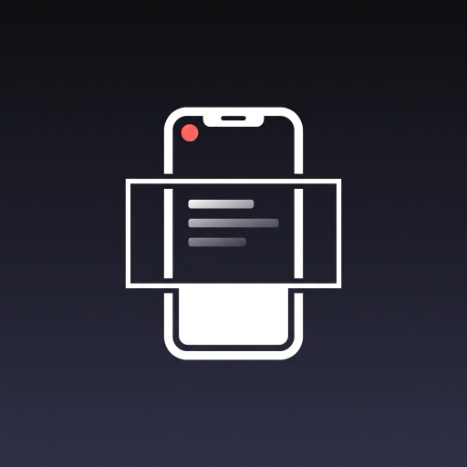

<p align="center">
  
</p>

<h1 align="center">Una Toma</h1>

<p align="center">
  Graba <b>una vez</b>, publica en <b>todos lados</b>.<br/>
  Teleprompter + grabación en 4K vertical + exportación automática en 9:16 y 16:9.
</p>

<p align="center">
  <a href="https://github.com/jaimeirazabal1/una-toma/actions/workflows/ci.yml"></a>
  
  
  
  <a href="LICENSE"></a>
</p>

---

Una Toma es una app Android para creadores de contenido. Lees tu guion desde un
teleprompter en pantalla mientras grabas en vertical, y la app exporta el mismo
video en dos formatos listos para subir:

| Formato | Resolución | Para |
|---|---|---|
| Vertical 9:16 | 2160×3840 (original, sin recomprimir) | Reels, TikTok, YouTube Shorts |
| Horizontal 16:9 | 1920×1080 | YouTube |

## Características

- **Grabación en 4K vertical** con cámara frontal o trasera (CameraX).
- **Preview en tres modos:** 9:16, 16:9 y "Ambos", que resalta la franja 16:9
  sobre el cuadro vertical para que veas qué entra en cada versión.
- **Teleprompter con scroll automático:**
  - velocidad, tamaño de letra y opacidad configurables;
  - un toque pausa o reanuda;
  - arrastra con el dedo para adelantar o retroceder mientras el texto sigue corriendo;
  - reinicio rápido y cuenta atrás antes de grabar.
- **Filtros a un toque:** Natural, Glow, Rosado, Cálido, Frío, Vívido, Cine, Vintage y B/N, con control de
  intensidad. Se ven en vivo en el preview, se pueden cambiar mientras grabas y quedan en los dos videos
  exportados. El video se graba limpio y el filtro se aplica al exportar.
- **Exportación automática** a la galería (`Movies/Teleprompter`) y botón para compartir ambos archivos.
- El guion y los ajustes se guardan solos.

## Cómo funciona

Se graba un único archivo vertical a máxima resolución.

- La versión **vertical** es ese archivo tal cual: cero pérdida de calidad. Si usaste filtros, se
  re-codifica a la misma resolución aplicándolos.
- La versión **horizontal** es un recorte central 16:9 re-codificado en H.264
  con Media3 Transformer. Como parte de 4K (2160 px de ancho), el resultado es
  1080p reales, sin escalar hacia arriba.

> Si grabas en 1080p, el horizontal queda en ~1080×608 y se escala hacia arriba.
> Para YouTube conviene grabar en 4K.

## Stack

- Kotlin 2.2 · Jetpack Compose (Material 3) · Navigation Compose
- CameraX 1.4 (Preview + VideoCapture)
- Media3 Transformer 1.7 (recorte y re-codificación)
- DataStore (guion y ajustes)
- Coroutines · Flow · ViewModel · inyección de dependencias manual

## Arquitectura

```
app/src/main/java/com/jaime/teleprompter/
├── domain/   modelos y lógica pura del scroll (testeada en la JVM)
├── data/     DataStore, MediaStore, exportación con Media3
├── camera/   envoltorio de CameraX
└── ui/       pantallas: guion, grabación y exportación
```

Decisiones de diseño:

- **Filtros = una matriz de color.** Cada filtro se reduce a una transformación afín `out = A·in + b`
  (`ColorAffine`). La misma matriz alimenta el preview (`ColorMatrixColorFilter`) y la exportación
  (`RgbMatrix` de Media3), así que lo que ves es lo que sale. La intensidad es una interpolación lineal.
- **Línea de tiempo de filtros.** Si cambias de filtro grabando, se anota el instante y la exportación
  aplica cada filtro en su tramo (`FilterTimeline`).
- **Una sola grabación, dos salidas.** Evita grabar dos veces y garantiza que
  ambos formatos son exactamente la misma toma.
- **`TeleprompterMath` separado de Compose.** La lógica del scroll es una
  función pura con tests unitarios; la UI solo la observa.
- **`ExportCoordinator` a nivel de aplicación.** Rotar la pantalla o navegar no
  interrumpe una exportación en curso.
- **DI manual (`AppContainer`).** Suficiente para este tamaño y sin el coste de
  compilación de kapt/ksp.

## Compilar y ejecutar

Requisitos: JDK 17, Android SDK (compileSdk 36) y un dispositivo con Android 10
o superior (minSdk 29). La cámara requiere un dispositivo físico.

```bash
./gradlew testDebugUnitTest   # tests unitarios
./gradlew installDebug        # compila e instala en el dispositivo conectado
```

## Limitaciones conocidas

- La exportación corre en primer plano; si minimizas la app durante una
  exportación larga puede pausarse.
- El video horizontal es solo la franja central del cuadro vertical.
- El build release aún no está minificado ni firmado.
- No hay ícono monocromático para los íconos temáticos de Android 13+.

## Hoja de ruta

- [ ] Exportación en segundo plano (WorkManager + servicio en primer plano)
- [ ] Reencuadre manual de la franja horizontal
- [ ] Opción de bajar el vertical a 1080×1920 para archivos más ligeros
- [ ] Filtros de retoque de piel (suavizado) con shader propio
- [ ] Espejo del texto para uso con cristal de teleprompter
- [ ] Ícono monocromático y localización a inglés

## Licencia

[MIT](LICENSE) © 2026 Jaime Irazabal
